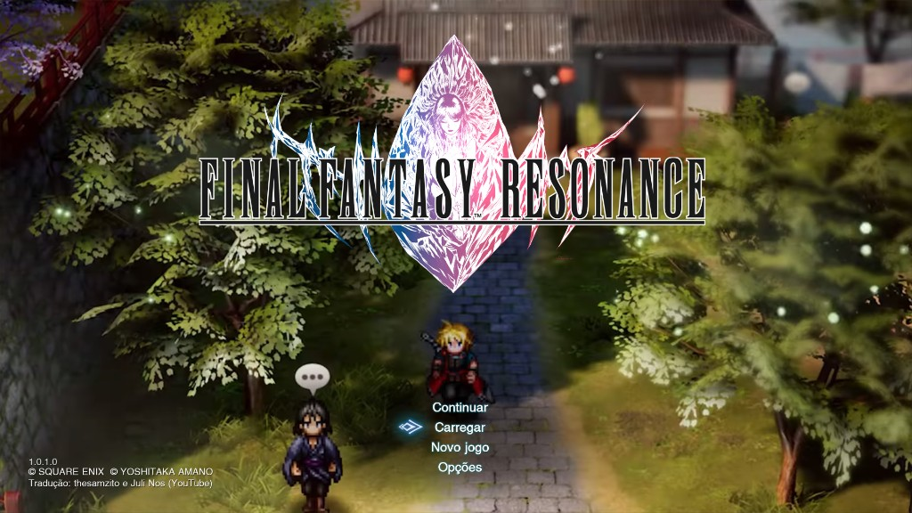
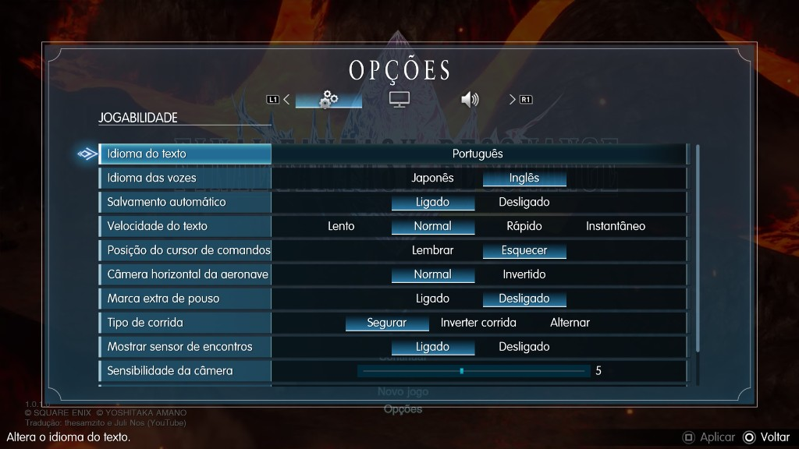

# Tradução PT-BR — FINAL FANTASY RESONANCE PARA PS5 (PPSA31544)

**Não inclui o jogo.** Só o locres e o script de injeção.

Tradução: thesamzito (YouTube) e Juli Nos (YouTube).

## Screenshots





## Requisitos

- **Python 3 instalado no PC.** Baixe em https://www.python.org/downloads/ e, na instalação, deixe marcada a opção **Add python.exe to PATH**. É só instalar; não precisa configurar mais nada.
- Dump `PPSA31544-app0` (o mesmo do PS5, com `ffrs\content\paks\ffrs-ps5.pak` e `ampr_emu.index`)


## Como instalar

Mantenha juntos: `en-Game.locres.bin`, `aplicar_traducao.py`, `aplicar_traducao.bat` (e o `.vbs`, se vier no zip).

Jeito mais simples: dê dois cliques em `aplicar_traducao.py` (ou no `.vbs`) e escolha a pasta `PPSA31544-app0`.

Também pode arrastar a pasta do jogo em cima do `aplicar_traducao.bat` ou do `.vbs`. A janela fica aberta no final — se fechar sozinha, use o `.py` / `.vbs`.

Se preferir colar o caminho:

```bat
aplicar_traducao.bat "D:\caminho\PPSA31544-app0"
```

Não funciona colando `~mods` de PC na pasta de paks. Neste dump o texto tem de ir **dentro** do `ffrs-ps5.pak`.


O script faz backup `ffrs-ps5.pak.before-pt.bak`, troca o locres e atualiza o `ampr_emu.index`. Se já estiver aplicado, mostra `ja aplicado, nada a fazer`.
